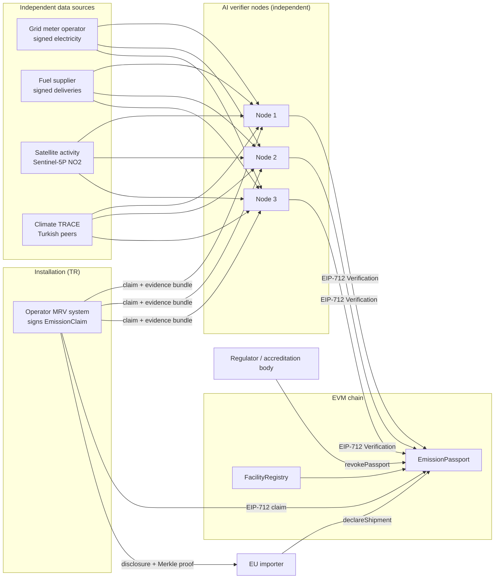
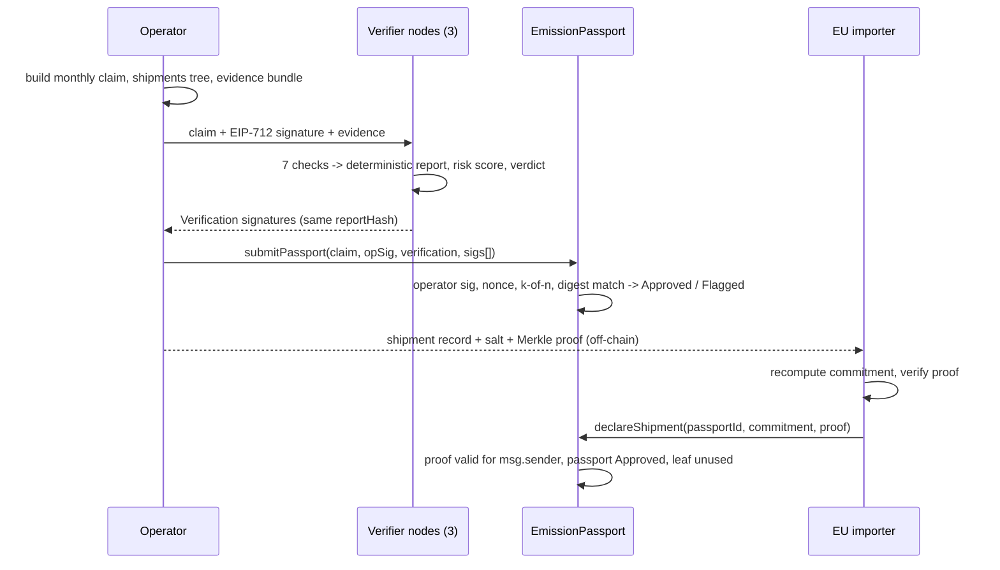

# Architecture & technical specification

## Actors and trust boundaries



Every arrow that crosses a boundary carries a signature or a hash commitment:

| Boundary | Mechanism |
|---|---|
| Operator → anyone | EIP-712 `EmissionClaim` signed by the key in `FacilityRegistry` |
| Feeds → verifiers | EIP-191 signature over canonical JSON. The signer must be on the trust list and the scope (installation, period) must match. |
| Verifiers → chain | EIP-712 `Verification` over the exact claim digest. At least `verifierThreshold` distinct registered verifiers must sign. |
| Off-chain files → chain | `evidenceHash` = keccak256(evidence bundle bytes), `reportHash` = keccak256(report bytes), `modelHash` = keccak256(verifier code, factors, ML configuration, benchmarks) |
| Producer → importer | Salted commitment per shipment; leaf = keccak256(keccak256(abi.encode(importer, commitment))); Merkle root inside the claim |

## Sequence



## Smart contracts (Solidity 0.8.28, OpenZeppelin 5)

### `FacilityRegistry`
- `registerFacility(name, installationId, country, sector, route, operatorKey)`. Restricted to `REGISTRAR_ROLE`.
- `rotateOperatorKey`, `setActive`, `getFacility`, `operatorOf`, `isActive`.

### `EmissionPassport`

EIP-712 domain: `EmisPass` / `1` / chainId / contract address.

```
EmissionClaim(uint256 facilityId,uint32 period,uint256 productionTonnes,uint256 directEmissionsKg,
              uint256 indirectEmissionsKg,bytes32 shipmentsRoot,bytes32 evidenceHash,uint256 nonce)
Verification(bytes32 claimDigest,uint8 verdict,uint16 riskScore,bytes32 modelHash,bytes32 reportHash)
```

| Function | Rules |
|---|---|
| `submitPassport(claim, operatorSig, verification, verifierSigs[])` | Anyone can relay it. Requirements: the facility is active; `nonce == facilityNonce`; the period is valid; the operator signature recovers to the registered key; `verification.claimDigest == hashClaim(claim)`; at least the threshold of distinct `VERIFIER_ROLE` signers. Duplicates and unknown keys are ignored. Status becomes Approved or Flagged. A period can be resubmitted only if no Approved passport exists for it. |
| `revokePassport(id, reason)` | `REGULATOR_ROLE` |
| `verifyShipment(id, importer, commitment, proof)` | View. True only for Approved passports. |
| `declareShipment(id, commitment, proof)` | The leaf is bound to `msg.sender` and can be declared only once (`declaredUnder`). |
| `setVerifierThreshold(k)` | `DEFAULT_ADMIN_ROLE`, k > 0 |
| `specificEmissions(id)` | kgCO2e per tonne, direct and indirect |

Custom errors make every rejection explicit: `BadNonce`, `BadOperatorSignature`, `VerificationDoesNotMatchClaim`, `InsufficientVerifierSignatures`, `PeriodAlreadyApproved`, `InvalidShipmentProof`, `ShipmentAlreadyDeclared`, and others.

## AI verifier (`verifier/emispass`)

| # | Check | Type | Signals the operator does not control |
|---|---|---|---|
| 1 | Provenance | rule | Feed signatures and trust list |
| 2 | Activity reconciliation | rule | Grid meter (±2 %) and supplier deliveries (±5 %) |
| 3 | Independent recalculation | rule | IPCC 2006 factors applied to supplier and meter data |
| 4 | Turkish peer benchmark | data | Climate TRACE p10–p90 by production route (real data) |
| 5 | Expected intensity | ML: `GradientBoostingRegressor` | Fuel deliveries, metered electricity, satellite activity per tonne |
| 6 | Monthly anomaly | ML: `IsolationForest` + robust z | The facility's own verified history |
| 7 | Satellite consistency | rule | Production implied by the satellite activity signal |

The risk score is the sum of severity points (info 0, low 40, medium 120, high 300, critical 600), capped at 1000. The verdict is **FLAGGED** if the score is at least 400 or any finding is critical. The ML outputs can only raise risk; no model can approve a claim on its own.

The pipeline is deterministic: fixed seeds, canonical JSON, no timestamps in reports. Honest nodes therefore produce byte-identical reports, and the orchestrator refuses to aggregate signatures if the report hashes differ.

## Data model off-chain

- `out/evidence/<tag>.json`: the operator declaration, both signed feeds and the satellite record. Its hash is `evidenceHash`.
- `out/reports/<tag>.json`: findings with numbers, the CBAM view and model metadata. Its hash is `reportHash`.
- `out/disclosures/<shipmentId>.json`: one shipment's values, salt, commitment and Merkle proof, given only to its importer.

In production these files go to content-addressed storage such as IPFS or Filecoin, with access control for the evidence bundle.

## Production data sources (connectors)

| Demo stand-in | Production source |
|---|---|
| Synthetic grid mix | EPİAŞ Şeffaflık Platformu real-time generation (free account, TGT ticket). `sources/grid.py` turns any mix into gCO2/kWh. |
| Synthetic NO2 index | Sentinel-5P TROPOMI L2 NO2 (Copernicus Data Space or Planetary Computer), as a monthly buffer mean around the plant |
| Signed meter feed | Distribution company / EPİAŞ settlement meter data, signed by the data owner |
| Signed fuel feed | e-invoice (e-Fatura) or customs (GİB, BOTAŞ, port) records, signed at source |
| Climate TRACE cache | Live API `api.climatetrace.org/v6/assets?countries=TUR&subsectors=…` (`python -m emispass fetch-climatetrace`) |
